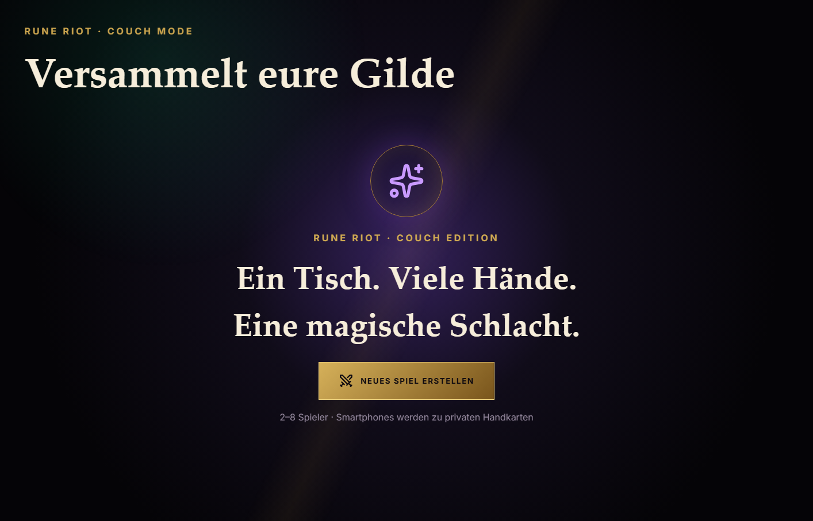
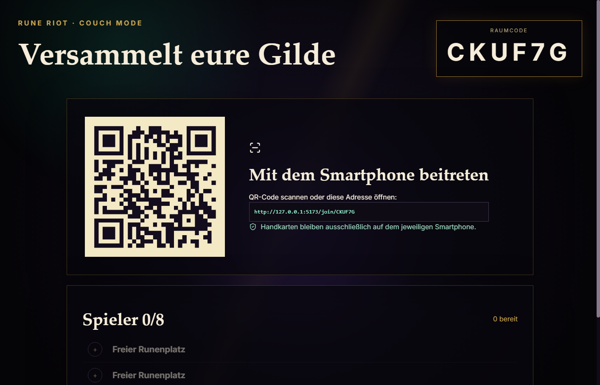
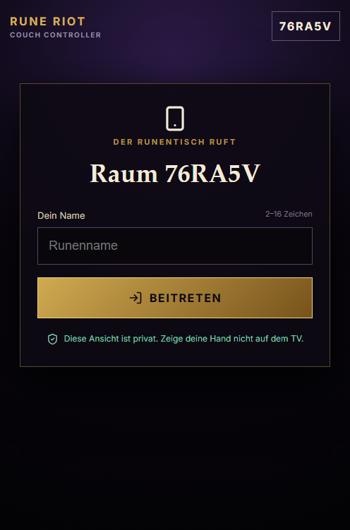
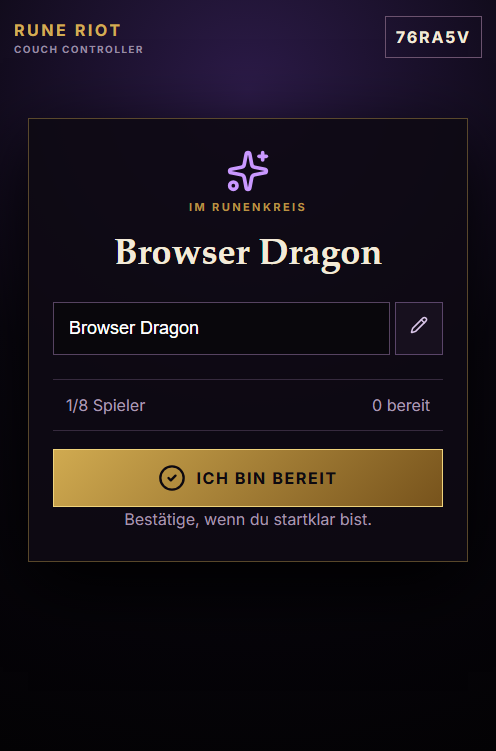
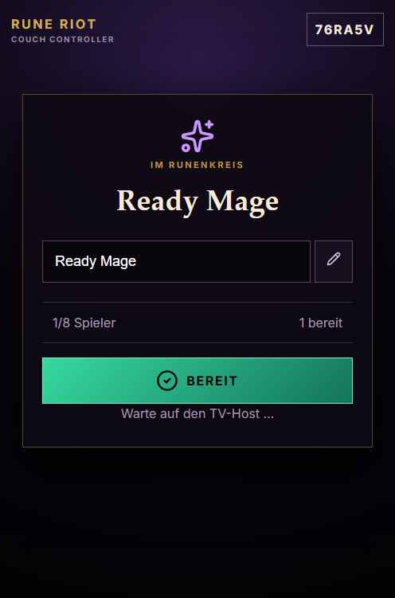

# RUNE RIOT Alpha 0.3 – Couch Mode Foundation

Stand: 26. Oktober 2026  
Branch: `feat/alpha-0.3-couch-mode`

## Ergebnis

Alpha 0.3 ergänzt den bestehenden Webmodus um einen getrennten Couch Mode:

- `/couch` ist ein neutraler TV-Host mit Startbildschirm, privatem Raum, QR-Code, Bereitschaftsliste, öffentlichem Spieltisch und Siegeransicht.
- `/join/:roomCode` ist die private Smartphone-Oberfläche für Name, Bereitschaft, eigene Handkarten und sämtliche vorhandenen Spielentscheidungen.
- Der vorhandene Cloudflare-Durable-Object-Server und die vorhandene Regel-Engine bleiben autoritativ. Es wurde keine zweite Engine und kein neuer Regelsatz angelegt.
- Der TV wird nicht als Spieler gesetzt. Er kann keine Kartenaktionen senden und erhält nie private Handkarten oder geheime Auswahlzustände.
- Der bisherige Online-, Bot-, Account- und Statistikmodus bleibt technisch erhalten und wird im Couch Mode lediglich nicht angezeigt.

Es erfolgte kein Deployment und keine Änderung an Supabase-Migrationen.

## Architektur

### Rollen und Datenfluss

Ein Couch-Raum verwendet dieselbe Room-Durable-Object-Instanz wie der klassische Onlinemodus, besitzt aber das persistierte Merkmal `couch`.

1. Der TV erstellt per authentifiziertem `POST /rooms` einen privaten Couch-Raum.
2. Der TV authentifiziert seinen WebSocket mit `couch-auth`. Der Server prüft, dass das Supabase-Subject dem bei der Raumerstellung gespeicherten Host entspricht.
3. Smartphones authentifizieren sich weiterhin mit anonymen Supabase-Sitzungen und erhalten dadurch stabile serverseitige User-IDs. Namen dienen nur der Anzeige.
4. Spieler erhalten personalisierte `PersonalView`-Snapshots mit ausschließlich ihrer eigenen Hand.
5. Der TV erhält einen ausdrücklich erzeugten `PublicView`: `you`, `pendingDrawnWildCard` und `pendingDiscardAllCards` sind immer `null`. Ziehereignisse werden zu öffentlichen Anzahlen reduziert.
6. Alle Kartenaktionen laufen unverändert als Intents durch `applyIntent` und die bestehende Engine.

### Berechtigungen

- Nur die verifizierte `display`-Rolle des Couch-Hosts darf die Partie starten oder Spieler entfernen.
- `display`-Sockets dürfen ausschließlich `ping`, `start` und `kick` senden. Ein Spiel-Intent des TVs wird serverseitig abgewiesen.
- Start ist erst ab zwei verbundenen Spielern möglich und nur, wenn alle verbundenen Spieler bereit sind.
- Couch-Räume sind privat und werden nicht im Public-Room-Verzeichnis registriert.
- Couch-Räume sind auf acht Spieler begrenzt; der bestehende Online-Grenzwert bleibt unverändert.
- Namen sind 2–16 Unicode-Codepoints lang, werden als Text gerendert und pro Raum Unicode-normalisiert sowie ohne Beachtung der Groß-/Kleinschreibung auf Eindeutigkeit geprüft.
- Namen können nur in der Couch-Lobby geändert werden und bleiben bei Reconnect und während einer Partie erhalten.
- Zugangstokens werden ausschließlich in Auth-Headern beziehungsweise der ersten WebSocket-Nachricht übertragen, nicht in URLs oder Logs.

## Implementierte Oberfläche

### TV

- eigenständiger Couch-Edition-Startbildschirm mit „Neues Spiel erstellen“
- großer Raumcode und lokal erzeugter QR-Code
- vollständiger LAN-Beitrittslink als Fallback
- Liste für 2–8 Spieler mit Online- und Bereitschaftsstatus
- deaktivierter Startknopf, bis mindestens zwei Spieler verbunden und alle bereit sind
- öffentlicher Runentisch mit Zieh- und Ablagestapel, aktueller Farbe, Spielrichtung, aktivem Spieler, Namen und Kartenzahlen
- Sieger-Overlay und Revanchestart im selben Raum
- keine Account-, Ranglisten-, Daily-, Quick-Match- oder Claim-Elemente

### Smartphone

- für Hochformat optimierter Join-Ablauf
- Name mit verständlicher Validierung und lokalem Merken pro Raum
- Umbenennen und Bereitschaft in der Lobby
- Verbindungs- und Zugstatus
- eigene Hand über den vorhandenen `HandFan` und die vorhandenen RUNE-RIOT-Kartenassets
- Ziehen, Ausspielen, Farbwahl, Farbroulette, Handtausch, Discard-All-Auswahl, Skip-Swap und RUNE/UNO-Ruf über die bestehenden Server-Intents
- klarer Gewinn-/Verlustzustand
- große Touch-Ziele; keine Hover-Pflicht

`prefers-reduced-motion` wird für die neu hinzugefügten Ladeanimationen berücksichtigt. Die vorhandenen Karten- und Handanimationen behalten ihre bestehende Motion-Behandlung.

## Lokaler Start und Heimnetz

Ein Doppelklick auf `Start-Rune-Riot.bat`:

1. prüft Node.js/npm und installiert fehlende Abhängigkeiten,
2. übernimmt ausschließlich die bereits vorhandenen öffentlichen Supabase-Werte,
3. wählt eine aktive private IPv4-Adresse,
4. bindet Vite und Wrangler exakt an diese Adresse,
5. setzt den QR-Ursprung und die zusätzliche CORS-Origin auf exakt diese Adresse,
6. wartet auf beide lokalen Dienste und öffnet `/couch`.

Bei mehreren Netzwerkkarten oder VPNs sollte die Adresse ausdrücklich gewählt werden:

```text
Start-Rune-Riot.bat -LanHost 192.168.x.x
```

Alternativ kann `RUNE_RIOT_LAN_HOST` gesetzt werden. Es wird weder `0.0.0.0` noch eine pauschale Origin-Freigabe verwendet. WebSocket-Upgrades prüfen ebenfalls die Origin. Windows-Firewall-Regeln werden nicht automatisch verändert; falls Windows fragt, darf Node.js nur für das aktuelle private Netzwerk freigegeben werden.

Die bestehende Supabase-Anbindung und damit eine Internetverbindung bleiben für die anonyme Authentifizierung erforderlich. Eine Offline-Supabase-Installation ist nicht Teil dieser Alpha.

## Geänderte und neue Dateien

| Bereich | Dateien | Zweck |
|---|---|---|
| Protokoll | `shared/protocol.ts` | Display-Rolle, Ready-Nachricht, öffentlicher Snapshot, Couch-Fehlercodes |
| Server | `game-server/src/index.ts`, `validate.ts`, `seats.ts` | Couch-Raum, Rollenprüfung, öffentliche TV-Sicht, Namen, Ready, Limit 8, exakte LAN-Origin |
| Servertests | `game.test.ts`, `validate.test.ts`, `seats.test.ts` | Datenschutz, Unicode-Namen, Duplikate und Kapazität |
| Frontend-Routing | `frontend/src/App.vue`, `utils/routes.ts` | `/couch` und `/join/:roomCode` als getrennte Oberflächen |
| TV | `components/couch/CouchHost.vue`, `stores/couchHostStore.ts` | Raumaufbau, QR, Lobby, öffentlicher Tisch, Reconnect |
| Smartphone | `components/couch/CouchController.vue`, `stores/multiplayerStore.ts` | Joinname, Ready und private Spielsteuerung |
| Tests | `utils/__tests__/routes.spec.ts`, `stores/__tests__/multiplayerStore.test.ts` | Deep Links, gewählter Name und Ready-Frame |
| Start | `scripts/Start-Rune-Riot.ps1`, `frontend/.env.example`, `README.md` | exakte LAN-Adresse, QR-URL, CORS und Anleitung |
| Werkzeuge | `scripts/smoke-couch.mjs`, `scripts/capture-local-page.mjs` | reproduzierbarer Protokoll-Smoke-Test und lokale Browser-Screenshots |
| QR | `frontend/package.json`, `package-lock.json` | `qrcode` 1.5.4 plus TypeScript-Typen; lokale Erzeugung ohne externen Dienst |

Bestehende Lizenzdateien und Hinweise wurden nicht entfernt. `qrcode` ist MIT-lizenziert.

## Qualitätssicherung

### Ausgeführte Prüfungen

| Prüfung | Ergebnis |
|---|---|
| Frontend-Produktionsbuild (`npm run build`) | bestanden |
| Game-Server-Typecheck (`npm run typecheck`) | bestanden |
| vollständige Vitest-Suite | 570 bestanden, 1 absichtlich übersprungen |
| deterministischer Bot-Test isoliert | 10/10 bestanden |
| lokaler Launcher auf `127.0.0.1` | beide Dienste und Healthcheck gestartet |
| echter Couch-Protokoll-Smoke-Test | Raum + 2 Spieler + Ready + Hoststart bestanden |
| TV-Datenschutz im echten Smoke-Test | kein `hand`-Feld und keine private Auswahl im TV-Snapshot |
| Smartphone-Browser: Join → Lobby → Ready | bestanden, keine Browser-Konsolenfehler |
| TV-Browser: Start → Raum → QR-Lobby | bestanden, keine Browser-Konsolenfehler |
| Produktionsabhängigkeits-Audit | 4 bereits bestehende Findings: 2 moderat, 2 hoch; keine aus `qrcode` |

Beim ersten finalen Gesamtlauf überschritt ein rechenintensiver Bot-Determinismustest einmalig das vorhandene 5-Sekunden-Testlimit. Der isolierte Wiederholungslauf bestand in 1,48 Sekunden; der danach erneut ausgeführte Gesamtlauf bestand vollständig mit 570 Tests. Es wurde deshalb keine Engine- oder Testtimeout-Änderung vorgenommen.

### Abdeckung der geforderten 18 Szenarien

| # | Szenario | Nachweis |
|---:|---|---|
| 1 | Raum erstellen | echter Browser und Protokoll-Smoke-Test |
| 2 | Spieler tritt mit Name bei | echter Browser-Smoke-Test |
| 3 | doppelten Namen abweisen | automatisierter Normalisierungs-/Duplikattest und Servergate |
| 4 | zweiter Spieler tritt bei | Protokoll-Smoke-Test |
| 5 | Ready synchronisieren | Browser- und Storetest sowie Smoke-Test |
| 6 | Host startet | Protokoll-Smoke-Test |
| 7 | Karten privat zustellen | bestehende personalisierte Snapshot-Tests plus Smoke-Test |
| 8 | TV nur öffentlich | neuer Privacy-Test plus echter Smoke-Test |
| 9 | gültige Karte | bestehende Engine-/Game-Server-Tests |
| 10 | ungültige Aktion | bestehende Intent-Gate-Tests; Display-Intents zusätzlich serverseitig gesperrt |
| 11 | Karte ziehen | bestehende Engine-/Game-Server-Tests |
| 12 | Spezialkarten | bestehende vollständige Engine-Suite |
| 13 | aktiver Spielerwechsel | bestehende Engine-Suite |
| 14 | Reconnect | vorhandener Store-Reconnect bleibt aktiv; Couch-Name wird lokal und im Serverroster erhalten |
| 15 | Gewinner | bestehende Engine- und Storetests; TV-/Phone-Siegeransichten bauen erfolgreich |
| 16 | neue Runde | vorhandener Server-Rematch-Pfad und Storetests; TV bietet Revanchestart |
| 17 | TV und Phones im Heimnetz | Bindung/CORS/QR automatisiert geprüft; physischer Mehrgeräte-WLAN-Test offen |
| 18 | KI-Partien/Bestandstests | vollständige Suite bestanden; Bot-Determinismustest separat bestätigt |

Der Protokoll-Smoke-Test erzeugt kurzlebige anonyme Supabase-Sitzungen, gibt aber keine Tokens aus. Er startet eine echte lokale Durable-Object-Partie mit zwei Spielern und kontrolliert den öffentlichen TV-Snapshot.

## Screenshots

### Couch-Edition-Start



### TV-Raumlobby mit lokal erzeugtem QR-Code



### Smartphone-Beitritt



### Smartphone-Warteraum



### Smartphone bereit



## Bekannte Einschränkungen und offene Punkte

- Ein physischer Test mit TV/PC und mehreren Smartphones im selben WLAN konnte in dieser Entwicklungsumgebung nicht durchgeführt werden. Er ist vor Freigabe der Alpha auf realer Hardware erforderlich.
- Windows-Firewall-Regeln unterscheiden sich je Gerät. Der Launcher verändert sie bewusst nicht; eine Betriebssystemabfrage muss gegebenenfalls vom Benutzer für das private Netzwerk bestätigt werden.
- Couch Mode benötigt weiterhin das konfigurierte Supabase-Projekt und Internetzugang für anonyme Identitäten.
- Optionale KI-Sitze wurden nicht in Couch-Räume aufgenommen. Bestehende KI-Partien bleiben unverändert verfügbar; Alpha 0.3 priorisiert 2–8 Menschen.
- Voice, Freunde, Ranglisten und andere Online-Oberflächen werden im Couch Mode absichtlich nicht geladen.
- Die vorhandenen Audit-Findings liegen in `@cloudflare/realtimekit`/dessen `uuid` sowie `@mcp-b/transports`/`zod`. Verfügbare automatische Korrekturen wären Major-Upgrades und wurden außerhalb dieses Modus-Scopings nicht angewendet.
- Der Produktionsbuild meldet weiterhin die bereits bekannte Warnung zu großen Chunks und zur statisch sowie dynamisch importierten Supabase-Datei; der Build ist erfolgreich.

## Manuelle Abnahme vor Alpha-Verteilung

1. `Start-Rune-Riot.bat` per Doppelklick starten.
2. Prüfen, dass der Browser `/couch` auf der angezeigten LAN-IP öffnet.
3. Mit mindestens zwei echten Smartphones im selben WLAN den QR-Code scannen.
4. Namen vergeben, Ready setzen und am TV starten.
5. Mindestens eine Partie inklusive Wild-Farbwahl, Ziehen und Sieger-/Revancheseite spielen.
6. Während des Spiels ein Smartphone sperren/entsperren und den Reconnect prüfen.
7. Falls ein Gerät den Link nicht erreicht, Windows-Firewallprofil und die mit `-LanHost` gewählte Netzwerkkarte prüfen.

