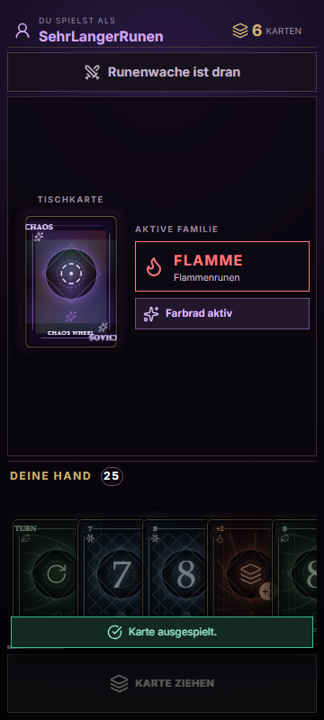
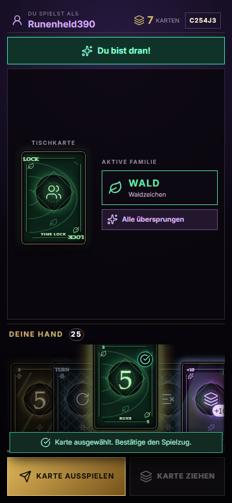
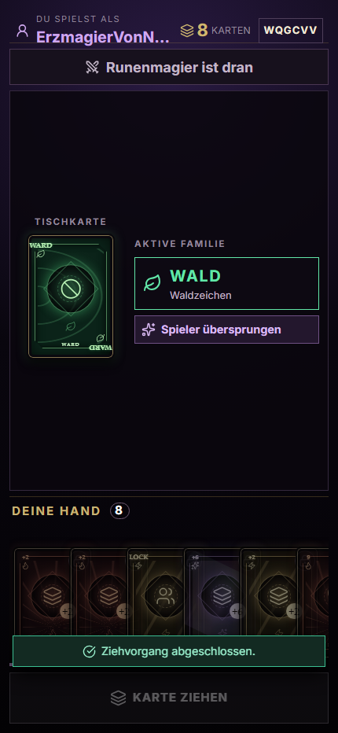

# RUNE RIOT Alpha 0.3.1 – Mobile UX Refinement

Stand: 26. Oktober 2026
Branch: `feat/alpha-0.3.1-mobile-ux`

## Ergebnis

Alpha 0.3.1 überarbeitet ausschließlich den privaten Couch-Controller unter `/join/:roomCode`. Die TV-Ansicht, die Regel-Engine, das Multiplayer-Protokoll, der Game-Server, die Authentifizierung und die Supabase-Migrationen wurden nicht verändert.

Der Smartphone-Controller besitzt nun eine eindeutige visuelle und interaktive Hierarchie:

1. kompakter Spielerstatus mit Name, Kartenanzahl und Raumcode,
2. klarer Zug- beziehungsweise Verbindungsstatus,
3. große Tischkarte mit aktiver Runenfamilie und laufendem Karteneffekt,
4. private, horizontal scrollbare Hand,
5. kontextabhängige Aktionsleiste für Ausspielen, Ziehen und RUNE-Ruf.

Es erfolgte kein Deployment und es wurde kein neuer Dienst oder keine neue Abhängigkeit hinzugefügt.

## Mobile Bedienung

### Zwei-Schritt-Auswahl

- Ein erster Tap markiert eine spielbare Karte deutlich und hebt sie an.
- Ein zweiter Tap auf dieselbe Karte hebt die Auswahl wieder auf.
- Ein Tap auf eine andere spielbare Karte wechselt die Auswahl.
- Erst `Karte ausspielen` sendet den vorhandenen Spiel-Intent.
- Während eine Karte gewählt ist, ist `Karte ziehen` gesperrt. Damit können Ziehen und Ausspielen nicht versehentlich gleichzeitig ausgelöst werden.
- Wird ein Intent serverseitig abgewiesen, stellt der vorhandene optimistische Rollback die Hand wieder her. Die Auswahl bleibt bestehen und der Controller zeigt eine verständliche Meldung.

Die authoritative Prüfung verwendet weiterhin unverändert `canPlayCard` und den bestehenden Multiplayer-Store. Es wurde keine zweite Regelimplementierung angelegt.

### Handkarten

Für Couch-Telefone existiert jetzt `CouchHand.vue`. Die Komponente verwendet weiterhin die vorhandene RUNE-RIOT-Karte `Card.vue`, ergänzt jedoch eine Smartphone-spezifische Bedienung:

- 102 × 143 Pixel große Kartenziele,
- kontrollierte Überlappung um 30 Pixel,
- horizontaler Touch-Scroll mit `overscroll-behavior` und Scroll-Snapping,
- grünes Prüfzeichen für spielbare Karten,
- Schloss und reduzierte Helligkeit für nicht spielbare Karten,
- angehobene Auswahl mit Text `AUSGEWÄHLT`,
- Scrollhinweis ab zehn Karten,
- kompaktere Darstellung auf niedrigen Viewports,
- keine Hover-Abhängigkeit.

Farben sind nicht das einzige Unterscheidungsmerkmal: Familie, Kartentitel, Zahl beziehungsweise Aktionssymbol und Playability-Symbol bleiben sichtbar.

### Status und Aktionen

Der Controller unterscheidet sichtbar:

- `Du bist dran!`,
- `<Name> ist dran`,
- Farb-, Tausch- und Discard-All-Entscheidungen,
- aktiven Ziehstapel,
- erneuten Verbindungsaufbau,
- unterbrochene Verbindung.

Der Ziehbutton heißt ohne Stapel `Karte ziehen` und bei einer Strafe beispielsweise `10 Karten ziehen`. Gültige, ungültige und abgeschlossene Aktionen erhalten eine kurze Rückmeldung. Lange Spielernamen werden im kompakten Kopfbereich abgeschnitten, ohne Kartenanzahl oder Raumcode zu verdrängen.

Animationen beschränken sich auf Auswahl, Statusleuchten, Feedback und bestehende Kartenmechanismen. `prefers-reduced-motion` deaktiviert die neuen Bewegungen und Übergänge.

## Geänderte Dateien

| Datei | Zweck |
|---|---|
| `frontend/src/components/couch/CouchController.vue` | neue mobile Hierarchie, Zwei-Schritt-Aktion, Status, aktive Familie, Aktionsleiste und responsive Regeln |
| `frontend/src/components/couch/CouchHand.vue` | Couch-spezifische scrollbare Kartenhand mit Playability- und Auswahlzuständen |
| `frontend/src/utils/couchController.ts` | pure UX-Helfer für Status, Ziehtext, Auswahl und Handhinweis |
| `frontend/src/utils/__tests__/couchController.spec.ts` | Tests für Auswahl, Zustände, Ziehstapel und relevante Handgrößen |
| `frontend/src/stores/multiplayerStore.ts` | verständlicher Fehlerzustand für `invalid-intent`; bestehender Rollback bleibt unverändert aktiv |
| `frontend/src/stores/__tests__/multiplayerStore.test.ts` | Regressionstest für Fehlermeldung und Rollback |
| `scripts/capture-local-page.mjs` | exakte mobile Viewports, Overflow-Messung und sichtbare Browser-Aktionsresultate |
| `scripts/couch-ui-fixture.mjs` | kurzlebiger lokaler Couch-Raum für reproduzierbare Smartphone-Browserprüfungen |

`CouchHost.vue`, Shared Engine, Servercode, Protokolltypen, Authentifizierung und Migrationen besitzen in Alpha 0.3.1 keinen Diff.

## Qualitätssicherung

### Automatisiert

| Prüfung | Ergebnis |
|---|---|
| vollständige Vitest-Suite | 573 bestanden, 1 absichtlich übersprungen |
| neuer Couch-UX-Helfertest | 3/3 bestanden |
| bestehender Bot-Determinismustest isoliert | 10/10 bestanden, 1,19 s Testzeit |
| Game-Server-Typecheck (`npm run typecheck`) | bestanden |
| Frontend-Produktionsbuild (`npm run build`) | bestanden, 2.403 Module |
| bestehender Couch-Protokoll-Smoke-Test | bestanden: Raum, 2 Spieler, Ready, Hoststart, keine private Hand im TV-Snapshot |

Im ersten vollständigen Testlauf überschritt der bereits aus Alpha 0.3 bekannte Bot-Determinismustest einmalig sein bestehendes 5-Sekunden-Limit. Alle anderen 572 Tests bestanden. Der isolierte Lauf bestand in 1,19 Sekunden; der anschließende vollständige Wiederholungslauf bestand mit 573 Tests. Engine und Testlimit wurden für diese reine UI-Änderung bewusst nicht verändert.

Der Build meldet weiterhin die bekannten Hinweise zum statisch und dynamisch importierten Supabase-Modul sowie zu großen Chunks. Der Build endet erfolgreich; Alpha 0.3.1 fügt keine entsprechende Abhängigkeit hinzu.

### Echte lokale Browserstrecken

Die Prüfungen liefen in Edge Headless gegen das laufende lokale Frontend und den lokalen Durable-Object-Server. Der Test benutzte denselben LAN-Endpunkt wie die automatisch erzeugte `.env.local`. In allen drei Läufen meldete die Browserkonsole keine Fehler.

| Viewport | Tatsächlich geprüfte Strecke | Ergebnis |
|---|---|---|
| 360 × 800 | Join → Ready → Spielstart → Karte wählen → bestätigen; danach 25-Karten-Layoutstress | echter Spielzug 7→6 Karten; Hand horizontal scrollbar; Seite 0 px horizontaler und 0 px vertikaler Overflow |
| 390 × 844 | ungültige Karte, Auswahl, Abwahl, erneute Auswahl, Bestätigungszustand | verständliche Fehlermeldung; Auswahlzustände korrekt; Ziehen bei Auswahl gesperrt; 0 px Seitenoverflow |
| 430 × 932 | Join → Ready → `Karte ziehen`; danach Basisschrift auf 20 px/125 % | echte Hand 7→8; aktiver Spieler wechselte; Kopf und Aktionsleiste vollständig im Viewport; 0 px Seitenoverflow |

Die Handgrößen 3, 10, 15, 20 und 25 wurden im Browser als isolierter DOM-Layoutstress mit denselben gerenderten Karten geprüft. Das ist ausdrücklich kein manipuliertes Spielserver-Szenario. Ergebnis:

| Karten | Handbreite / sichtbare Breite bei 390 px | Verhalten |
|---:|---:|---|
| 3 | 366 / 366 px | vollständig sichtbar, kein unnötiger Scroll |
| 10 | 789 / 366 px | horizontal scrollbar |
| 15 | 1.149 / 366 px | horizontal scrollbar |
| 20 | 1.509 / 366 px | horizontal scrollbar |
| 25 | 1.869 / 366 px | horizontal scrollbar |

Das reale Spiel lieferte jeweils sieben Startkarten. Ausspielen, Ziehen, Wild-/Farbentscheidung, aktiver Spielerwechsel und ungültige Auswahl wurden gegen echte Server-Snapshots geprüft. Stacking, Reconnect und alle Spezialkarten bleiben zusätzlich durch die vollständige bestehende Engine-, Server- und Store-Suite abgedeckt.

## Screenshots

### 360 px – bestätigter Spielzug und 25-Karten-Layoutstress

### 390 px – gewählte Karte und Bestätigungsaktion

### 430 px – Ziehen und 125 % Basisschrift

## Offene Punkte und manuelle Abnahme

- Die Browserautomation emuliert Touch-Viewportgrößen, kann jedoch Haptik, Browserleisten, Safe Areas und reale Fingerbedienung nur näherungsweise abbilden. Vor Verteilung sollte je ein physisches iOS- und Android-Gerät geprüft werden.
- Ein echtes Sperren/Entsperren des Telefons wurde nicht automatisiert. Der bestehende Reconnect-Mechanismus und seine Storetests bestehen; ein Hardware-Reconnect bleibt Teil der manuellen Abnahme.
- Die Layoutstresstests für 10–25 Karten verwenden absichtlich geklonte vorhandene Kartenknoten. Eine lange reale Partie bis 25 Karten sollte ergänzend gespielt werden, ist aber für die CSS-Overflow-Aussage nicht erforderlich.
- Die TV-Ansicht wurde nicht visuell verändert. Ein kurzer Regressionstest mit TV plus zwei physischen Smartphones bleibt vor einer Alpha-Verteilung sinnvoll.

## Empfohlene manuelle Kurzabnahme

1. `Start-Rune-Riot.bat` starten und `/couch` am TV öffnen.
2. Mit zwei echten Smartphones beitreten und beide auf Ready setzen.
3. Auf einem kleinen Smartphone eine gültige und eine ungültige Karte antippen, Auswahl aufheben und anschließend bestätigen.
4. Ziehen, Wild-Farbwahl und einen Ziehstapel ausführen.
5. Ein Telefon sperren, entsperren und den wiederhergestellten Zugstatus prüfen.
6. Browser-Schriftgröße beziehungsweise Betriebssystem-Textgröße erhöhen und kontrollieren, dass Kopf, Hand und Aktionsleiste erreichbar bleiben.
