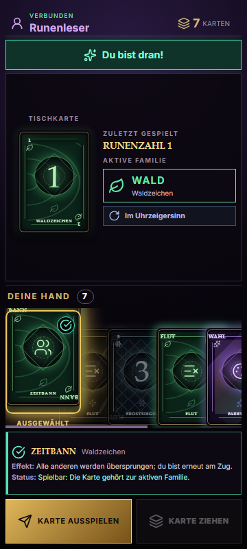
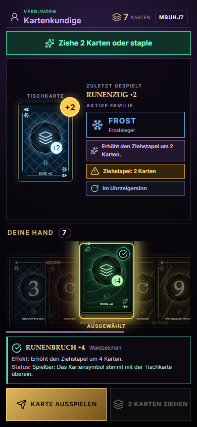
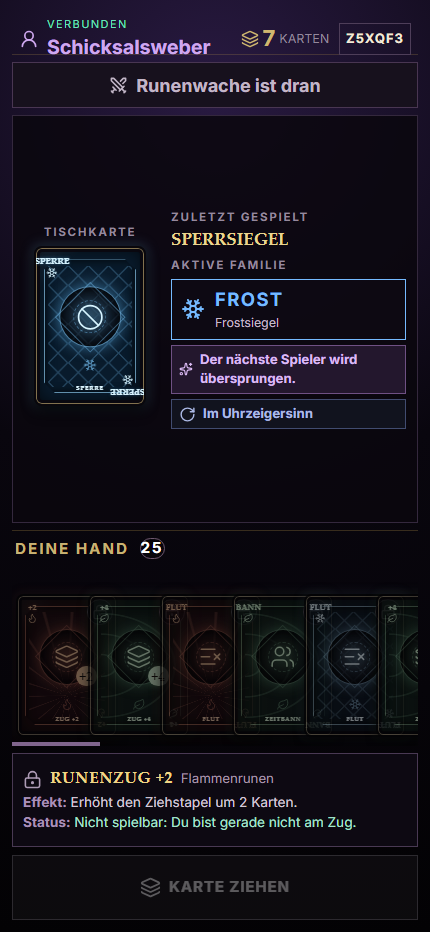
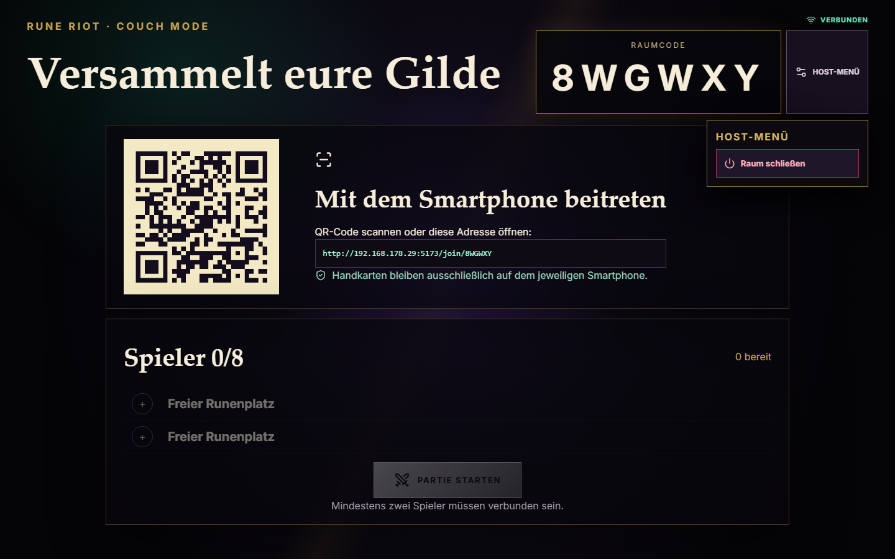

# RUNE RIOT Alpha 0.3.2 – Card Clarity & Couch Polish

Stand: 26. Oktober 2026

Branch: `feat/alpha-0.3.2-card-clarity`

Ausgangsstand: Commit `3358e9d`, lokaler annotierter Tag `alpha-0.3.1`

## Ergebnis

Alpha 0.3.2 macht die vorhandenen Karten und Couch-Abläufe verständlicher, ohne die Regel-Engine oder die Kartenverteilung zu verändern. Der Smartphone-Controller zeigt nun für jede echte Karte einen deutschen Namen, die Kartenfamilie, den tatsächlichen Effekt und eine Erklärung der vom bestehenden Regelhelfer ermittelten Spielbarkeit. Die Tischanzeige trennt die zuletzt gespielte Karte von der autoritativen aktiven Familie, der Ziehstrafe und der Spielrichtung.

Der TV-Host besitzt ein kompaktes, serverseitig autorisiertes Menü. Nach einem Rundenende kann er im selben Raum eine neue Runde starten oder alle verbundenen Geräte in die Lobby zurückführen. Spieleridentitäten und WebSocket-Verbindungen bleiben dabei erhalten. Doppelte Startanforderungen werden im Client abgefangen und weiterhin zusätzlich vom Server abgelehnt.

Es wurden keine neuen Karten, Regeln, Abhängigkeiten, Assets, Supabase-Migrationen oder kostenpflichtigen Dienste ergänzt. Es erfolgte kein Deployment.

## Tatsächlicher Kartenbestand

Die Zuordnung basiert auf `shared/engine/types.ts`, `deck.ts`, `rules.ts` und `engine.ts`. `frontend/src/utils/cardPresentation.ts` ist ausschließlich eine Präsentationsschicht. Ob eine Karte spielbar ist, entscheidet weiterhin der vorhandene `canPlayCard`-Regelhelfer; der Server validiert jeden Intent autoritativ.

| Technischer Typ | Deutscher Name | Tatsächliche Wirkung |
|---|---|---|
| `number` | Runenzahl N | Auf gleiche aktive Familie oder gleiche Zahl; ohne weiteren Effekt |
| `number`, Wert 0 | Runenzahl 0 | Rotiert die Hände aller aktiven Spieler in Spielrichtung, sofern die Karte nicht die eigene Hand leert |
| `number`, Wert 7 | Runenzahl 7 | Eröffnet die bestehende Auswahl zum Tausch der Hand mit einem aktiven Spieler |
| `skip` | Sperrsiegel | Überspringt den nächsten Spieler |
| `reverse` | Schicksalswende | Kehrt die Richtung um; zu zweit ist der ausspielende Spieler erneut am Zug |
| `draw2` | Runenzug +2 | Erhöht den aktiven Ziehstapel um 2 |
| `skipEveryone` | Zeitbann | Überspringt alle anderen; der ausspielende Spieler ist erneut am Zug |
| `discardAll` | Runenflut | Legt die übrigen Karten derselben Familie ab; die gewählte oberste Karte löst ihren Effekt aus |
| `wild` | Farbwahl | Wählt eine neue aktive Kartenfamilie |
| `draw4` | Runenbruch +4 | Farbgebundene Ziehkarte; erhöht den Ziehstapel um 4 |
| `draw6` | Arkaner Zug +6 | Wählt eine Familie und erhöht den Ziehstapel um 6 |
| `draw10` | Arkaner Zug +10 | Wählt eine Familie und erhöht den Ziehstapel um 10 |
| `wildReverseDraw4` | Schicksalsbruch +4 | Wählt eine Familie, kehrt die Richtung um und erhöht den Ziehstapel um 4 |
| `wildColorRoulette` | Chaos-Roulette | Der nächste Spieler wählt eine Familie und zieht bis zur ersten Karte dieser Familie |

Die bestehenden Stapelvarianten `official`, `house` und `casual` bleiben unverändert. Die Detailanzeige erklärt nur das bereits ermittelte Ergebnis und baut keine parallele Regelentscheidung auf.

## Smartphone-Controller

### Karten und Detailanzeige

- Alle Karten verwenden weiter das gemeinsame RUNE-RIOT-Mastertemplate und den vorhandenen Kartenrücken.
- Zahlen und Hauptsymbole bleiben groß; die Ecken tragen kompakte deutsche Kurzmarken.
- Zahlenkarten zeigen zusätzlich ihre Runenfamilie.
- Ein direkt an die Hand angrenzendes Detailfeld zeigt Name, Familie, Effekt und Status.
- Spielbare Karten behalten das grüne Prüfsymbol und die Hervorhebung.
- Nicht spielbare Karten bleiben abgedunkelt und mit Schloss gekennzeichnet; der Detailtext nennt den Grund.
- Die ausgewählte Karte erhält Goldrahmen und Anhebung. Das bestehende Zwei-Schritt-Ausspielen bleibt erhalten.
- Blockierte Karten können zur Erklärung betrachtet werden, lösen aber keinen Spiel-Intent aus.

### Autoritative Tischinformationen

Der Controller zeigt getrennt:

- die tatsächlich letzte Karte mit deutschem Namen,
- die vom Server gemeldete `current_color` als aktive Familie,
- den Effekt der Tischkarte, sofern relevant,
- den aktiven Ziehstapel,
- die aktuelle Spielrichtung.

Damit bleibt beispielsweise nach einer arkanen Farbwahl die gewählte aktive Familie maßgeblich, auch wenn die sichtbare Karte selbst die Familie `wild` besitzt.

### Name und Verbindung

Der zuletzt erfolgreich verwendete Anzeigename wird lokal global und raumbezogen gespeichert. In einem neuen Raum ist er nur eine editierbare Vorbelegung. Nur der vorhandene raumbezogene Sitzungs- und Supabase-Identitätsmechanismus löst einen Wiederbeitritt aus; der Name ist ausdrücklich kein Authentifizierungsmerkmal. Hände und Passwörter werden nicht gespeichert.

Der Controller unterscheidet sichtbar `Verbunden`, `Verbindung verloren` und `Verbindung wird wiederhergestellt`. Der vorhandene Reconnect-Mechanismus bleibt zuständig; Alpha 0.3.2 verteilt beim Reconnect keine Karten neu und sendet keine doppelten Spielzüge.

## TV-Host und weitere Runde

Das neue Host-Menü bietet:

- neue Runde nach einem Rundenende,
- Rückkehr aller Teilnehmer in die Lobby,
- Schließen des Raums,
- Entfernen eines Spielers ausschließlich vor Spielbeginn.

Abbrechende Aktionen verlangen eine zweite Bestätigung. `return-lobby`, `close-room` und Couch-Kicks werden im Durable Object gegen Raumtyp, Host-ID, Display-Rolle und zulässige Phase geprüft. Normale Spieler sowie fremde oder klassische Hosts erhalten `not-host`; ein Couch-Kick während einer Partie erhält `not-in-lobby`.

`Noch eine Runde` verwendet den vorhandenen Raum und die vorhandene Regelkonfiguration. Der Server erzeugt über die bestehende Engine einen frischen Spielzustand und sieben neue Karten je Spieler. Ein Pending-Guard im TV-Store verhindert Mehrfachklicks; der bereits vorhandene `already-started`-Schutz bleibt die serverseitige letzte Instanz.

Die TV-Ansicht zeigt den Verbindungszustand je Spieler. Beim Rundenende erscheinen Gewinner, Spielerübersicht, `Noch eine Runde` und `Zur Lobby`.

## Wesentliche Dateien

| Datei | Zweck |
|---|---|
| `frontend/src/utils/cardPresentation.ts` | vollständige deutsche Präsentationszuordnung und erklärende Statusmeldungen |
| `frontend/src/components/game/Card.vue` | deutsche, kompakte Beschriftung im bestehenden Mastertemplate |
| `frontend/src/components/couch/CouchCardDetail.vue` | zugängliche Detailanzeige direkt bei der Hand |
| `frontend/src/components/couch/CouchHand.vue` | Inspect-, Auswahl- und Sperrzustände |
| `frontend/src/components/couch/CouchController.vue` | Tischinformationen, Details, Name und Verbindungsstatus |
| `frontend/src/components/couch/CouchHost.vue` | Host-Menü, Verbindungsstatus und Rundenende |
| `frontend/src/stores/couchHostStore.ts` | Host-Aktionen, Pending-Guard und sauberes Raumende |
| `frontend/src/stores/multiplayerStore.ts` | Behandlung eines autorisiert geschlossenen Raums ohne Reconnect-Schleife |
| `shared/protocol.ts` | typisierte Host-Nachrichten und `room-closed` |
| `game-server/src/couchHostActions.ts` | pure Autorisierungsregel für Couch-Host-Aktionen |
| `game-server/src/index.ts` | autorisierte Lobby-Rückkehr, Raumende und geschützter Lobby-Kick |
| `scripts/smoke-couch-host-actions.mjs` | realer Mehrclient-Test für Host, neue Runde und Raumende |

## Qualitätssicherung

### Automatisiert

| Prüfung | Ergebnis |
|---|---|
| vollständige Vitest-Suite | **584 bestanden**, 1 vorhandener Test übersprungen; 58 Testdateien bestanden |
| vollständige Kartentyp-Zuordnung | bestanden; alle 12 technischen Typen plus Sonderwerte 0 und 7 geprüft |
| Couch-Host-Store | bestanden; Doppelstart, Moduserhalt, Lobby-Rückkehr und Raumende |
| Couch-Host-Autorisierung | bestanden; Display-Host erlaubt, Spieler/fremder Host abgelehnt, Kick nur in Lobby |
| neue Runde in der Engine | bestanden; identische IDs, gleicher Modus, frische gültige Sieben-Karten-Hände |
| Game-Server-Typecheck | bestanden (`tsc --noEmit`) |
| Frontend-Produktionsbuild | bestanden; 2.407 Module transformiert |
| `git diff --check` | bestanden; nur vorhandene Windows-Zeilenende-Hinweise |

Der Build meldet weiterhin die bekannten Hinweise zu großen Chunks und zum zugleich statisch und dynamisch importierten Supabase-Modul. Beide Hinweise bestanden bereits und verhindern den erfolgreichen Build nicht.

### Reale lokale Mehrclient-Strecke

Der neue WebSocket-Smoke-Test wurde gegen den lokalen Durable-Object-Server erfolgreich ausgeführt. Geprüft wurden:

1. ein normaler Spieler darf keine Host-Aktion ausführen,
2. zwei Telefone treten bei und werden bereit,
3. der Host startet die Runde,
4. ein doppelter Start wird abgelehnt,
5. der Host kehrt in die Lobby zurück,
6. dieselben zwei offenen Smartphone-Sockets und Benutzer-IDs bleiben erhalten,
7. beide Spieler werden erneut bereit und erhalten in einer neuen Runde je sieben frische Karten,
8. `official` bleibt als Regelmodus erhalten,
9. der autorisierte Host schließt den Raum und alle Clients erhalten `room-closed`.

Erfolgsausgabe: `Couch host actions passed: unauthorized action rejected; duplicate start rejected; same two phone identities received fresh 7-card rounds; lobby return and room close succeeded.`

Ein späterer Wiederholungslauf beider Supabase-basierten Smoke-Skripte wurde vom lokalen Auth-Dienst mit HTTP 429 (`over_request_rate_limit`) begrenzt. Das ist kein Spiel- oder Buildfehler; der erfolgreiche Lauf fand nach der letzten Serverlogikänderung statt. Die abschließenden 584 Tests und der Build liefen danach erfolgreich.

### Browser- und Responsive-Prüfung

Die Screenshots entstanden gegen lokales Frontend und lokalen Game-Server. Die Browserkonsole enthielt bei den Aufnahmen keine Fehler.

| Viewport | Prüfung | Ergebnis |
|---|---|---|
| 360 × 800 | echte Handkarte gewählt, Name/Familie/Effekt/Status, Aktionsdock | Detail vollständig lesbar; 0 px Seitenoverflow; Dock im Viewport |
| 390 × 844 | Runenbruch +4 gegen aktiven +2-Stapel, Tischkarte, Frost-Familie, Richtung | Sperrgrund, aktive Familie und Ziehstapel widerspruchsfrei; 0 px Seitenoverflow |
| 430 × 932 | 125 % Basisschrift und 25-Karten-DOM-Layoutstress | Hand scrollbar, Detail und Aktionen erreichbar; 0 px Seitenoverflow |
| 1.440 × 900 | TV-Lobby mit geöffnetem Host-Menü | Raum, Spielerstatus und Aktionen sichtbar; kein Seitenoverflow |

Der 25-Karten-Lauf ist ein gezielter DOM-Layoutstress mit vorhandenen Kartenelementen; der echte Serverzustand blieb unverändert bei sieben Handkarten. Einen vollständigen neuen Browser-Spielzug konnte die abschließende Sitzung nicht erneut automatisieren, weil die native Browsersteuerung nicht mehr verfügbar war. Tatsächliches Ausspielen und Ziehen wurden in Alpha 0.3.1 mit denselben unveränderten Intent-Pfaden gegen den Server geprüft; Alpha 0.3.2 deckt die dazugekommenen Auswahl-, Beschreibungs- und Storepfade automatisiert ab.

## Screenshots

### 360 px – Kartendetail und Auswahl

### 390 px – Tischzustand und Ziehstapel

### 430 px – große Schrift und 25-Karten-Layoutstress

### TV – Host-Menü

## Abdeckung der 20 Abnahmepunkte

| Nr. | Punkt | Status |
|---:|---|---|
| 1 | alle vorhandenen Kartentypen benannt | automatisiert bestanden |
| 2 | Beschreibungen entsprechen Engine | Codeprüfung und gezielte Tests bestanden |
| 3 | Zahlenkarten lesbar | Browserprüfung 360/390/430 bestanden |
| 4 | nicht spielbare Karten gekennzeichnet | Browser- und Komponententest bestanden |
| 5 | Auswahl eindeutig | Browserprüfung bestanden |
| 6 | Karte ausspielen | bestehender realer Alpha-0.3.1-Browserpfad und aktuelle Engine-/Storetests bestanden; finaler 0.3.2-Browserlauf offen |
| 7 | Karte ziehen | bestehender realer Alpha-0.3.1-Browserpfad und aktuelle Engine-/Storetests bestanden; finaler 0.3.2-Browserlauf offen |
| 8 | Farbwechsel und aktive Familie | autoritative Datenbindung und Tests bestanden; sichtbare Browserprüfung bestanden |
| 9 | Ziehstapel | Browserprüfung und Regeltests bestanden |
| 10 | Name beim erneuten Beitritt | Local-Storage-Test bestanden |
| 11 | Host startet neue Runde | Store-, Server- und Mehrclienttest bestanden |
| 12 | Smartphones bleiben verbunden | realer Mehrclienttest bestanden |
| 13 | gültige neue Kartenverteilung | Engine- und Mehrclienttest bestanden |
| 14 | Host-Aktionen autorisiert | Servertests und realer Negativtest bestanden |
| 15 | Abbruch und Reconnect | bestehende Store-/Server-Suite bestanden; echter Hardwareabbruch offen |
| 16 | keine privaten Karten am TV | bestehender Couch-Smoke- und Protokolltest bestanden |
| 17 | 360, 390 und 430 px | Browserprüfung bestanden |
| 18 | 20–25 Karten | DOM-Layoutstress bestanden; lange reale Partie offen |
| 19 | Produktionsbuild | bestanden |
| 20 | Server- und Regeltests | vollständige Suite und Typecheck bestanden |

## Offene manuelle Abnahme

- Je ein physisches iOS- und Android-Gerät prüfen: Safe Areas, Browserleisten, Zoom, Haptik und reale Fingerbedienung.
- Einen echten Verbindungsabbruch durch Sperren/Entsperren des Telefons sowie WLAN-Wechsel prüfen.
- Eine komplette Couch-Runde mit TV und mindestens zwei physischen Smartphones bis zum Rundenende spielen; danach `Noch eine Runde`, `Zur Lobby` und `Raum schließen` bedienen.
- Eine reale lange Partie mit 20–25 Handkarten ergänzend zum bestandenen Layoutstress prüfen.
- Die beiden finalen Browseraktionen Ausspielen und Ziehen bei wieder verfügbarer Browserautomation erneut als Alpha-0.3.2-End-to-End-Lauf protokollieren.

## Start und Deployment

Der bestehende lokale Start bleibt unverändert über `Start-Rune-Riot.bat` möglich. Alpha 0.3.2 benötigt keine weitere Einrichtung, keine neuen Zugangsdaten und keine Migration. Es wurde weder Frontend noch Game-Server öffentlich deployt.
